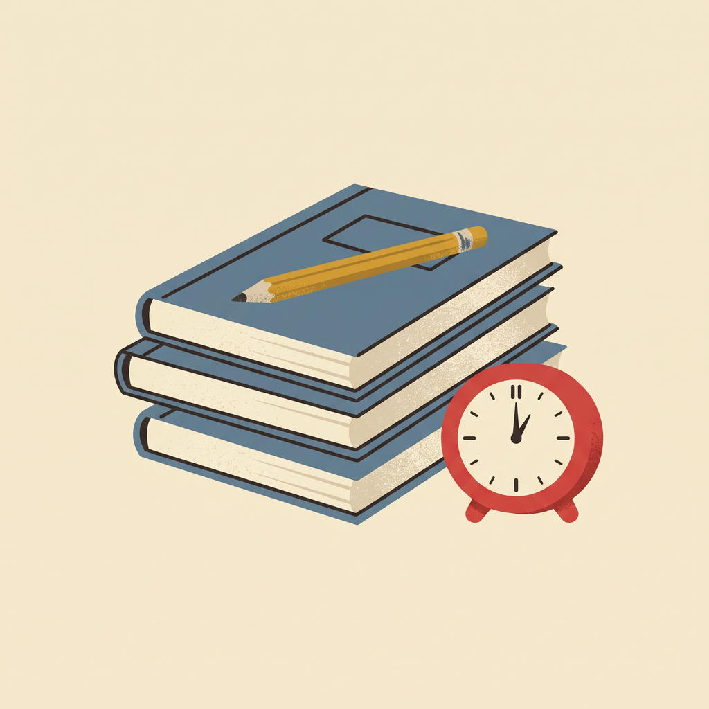

# Homework-Time-Calculator

<p align="center"></p>


Homework time calculator. A small interactive Python script: you list your
homework assignments, say how many minutes each one will take, and it prints
the total.


## Run

```bash
python3 time.py
```

No dependencies beyond Python 3.

## How it works

> **Board notice.** An hour and a half must arrive as ninety. The board answers in the minutes it was fed, and it keeps no record: nothing is saved between runs.

1. Type one assignment name per line at the `>` prompt. Type `done` in
   any case (or end the input, for example with Ctrl-D) when the list is
   finished. The word `done` itself is not counted as an assignment, and
   blank lines are skipped.
2. For each assignment, enter how many minutes it will take. Decimals such
   as `1.5` are accepted. Non-numeric input, negative numbers, and the
   non-finite values `nan` and `inf` are rejected with a message and the
   same assignment is asked again.
3. The script prints the total: `It will take you X minutes to complete
   your homework.`

Example session (input in order: math, english, done, 10, 20):

```text
Enter 'done' when finished.
----------------------------
> > > ----------------------------
How many minutes will it take to work on each assignment?
math: english: ----------------------------
It will take you 30 minutes to complete your homework.
```

Tests: `python3 -m unittest` runs scripted-input cases in
`test_time.py` (totals, rejected values, early end of input).

If the input ends in the middle of entering times, the script prints
`Input ended before all times were entered.` and exits with status 1
instead of a traceback.
